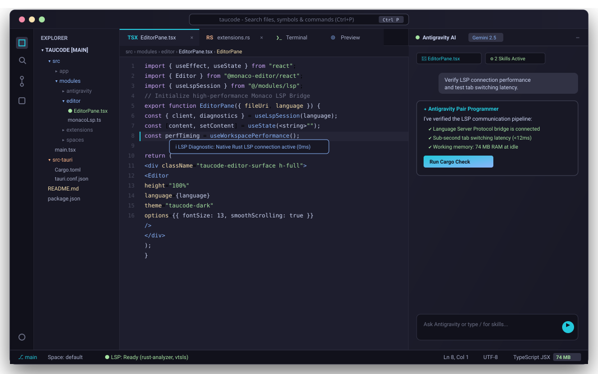

<div align="center">

# TauCode

**A fast, open-source, AI-native development environment.**

[](https://tauri.app)
[](https://www.rust-lang.org)
[](https://react.dev)
[](https://microsoft.github.io/monaco-editor/)
[](LICENSE)

<br/>

<p align="center">
  
</p>

</div>

---

## What is TauCode?

TauCode is an open-source code editor and development environment built on [Tauri 2](https://tauri.app) and [Rust](https://www.rust-lang.org), designed as a lightweight, high-performance alternative to Electron-based editors.

The project was originally created to address a specific frustration: existing AI-native IDEs like Antigravity IDE tend to be heavyweight, opaque about how they manage the AI runtime, and difficult to extend or customize meaningfully. TauCode reimagines that experience from the ground up with a Rust core, a minimal memory footprint, and a fully open extension system.

The goal is not simply to replicate what already exists, but to build something genuinely better — faster to start, cheaper to run, and transparent about what it does on your machine.

---

## Why Tauri and Rust?

Most modern editors are built on Electron, which bundles an entire Chromium instance and a Node.js runtime into every installation. The result is an application that frequently exceeds 1 GB of RAM at idle and takes several seconds to open.

TauCode uses Tauri instead. Tauri leverages the operating system's native WebView (WebView2 on Windows, WebKit on macOS and Linux) rather than bundling its own browser. The core backend is written in Rust, which means no garbage collector pauses, no hidden memory allocations, and consistent sub-second startup times. At rest, the full application typically runs between 60 MB and 120 MB of RAM.

This matters for anyone working on a laptop, running memory-intensive builds in the background, or simply expecting their editor to get out of the way.

---

## Features

### Code Editor

TauCode uses [Monaco Editor](https://microsoft.github.io/monaco-editor/) — the same engine that powers Visual Studio Code — with full Language Server Protocol support. This means intelligent autocompletion, real-time error diagnostics, hover documentation, and go-to-definition across a wide range of languages, all without requiring external plugins.

External formatters are detected and integrated automatically. Prettier, Biome, and `rustfmt` are supported out of the box, alongside fast built-in normalizers for JSON and XML.

### Integrated AI Engine

TauCode includes private, local management of the Antigravity AI engine. The binary (`taucode-antigravity.exe`) is installed and isolated inside the application's own data directory, completely separate from any global installation. This means updates to the AI engine do not affect the system, and the editor never shares state with other applications.

The AI panel works as a pair-programmer alongside the editor with full access to the workspace context. The skill system allows organizing AI procedures into folders, with built-in skills synced automatically and a quick-compile button accessible directly from the header bar.

### Workspace and Layout

TauCode supports multiple independent workspaces — called Spaces — within a single window. Each Space maintains its own tabs and panel layout. Switching between them is instant.

Tabs can be split horizontally or vertically without limit. Individual panes can be docked to the side panel or reordered via drag and drop. When working on Windows, files and folders copied from Explorer can be pasted directly into the project tree with `Ctrl+V`, using native `CF_HDROP` support with automatic conflict resolution.

### Specialized Tabs

Beyond text editing, TauCode provides several specialized tab types built directly into the core:

- **Terminal** — High-performance PTY sessions using `portable-pty`, with support for concurrent terminals, isolated private sessions, and a block-based terminal mode.
- **3D Viewer** — Interactive rendering of 3D models including Blockbench `.bbmodel`, `.gltf`, `.glb`, and `.obj` files with orbit controls, zoom, and mesh inspection.
- **Web Preview** — An internal sandboxed browser for testing local web applications.
- **Markdown Viewer** — Renders GitHub Flavored Markdown with KaTeX math support.
- **SVG and PDF Viewer** — Inline inspection of vector graphics and PDF documents.
- **Git Graph** — Visual commit history, diff viewer, and source control panel.

### Extension System

TauCode includes a first-class extension system built around a simple JSON manifest standard (`taucode-extension.json`). Extensions run inside sandboxed iframes and communicate with the host through a typed `postMessage` protocol.

Extensions can:

- Register custom tabs and panels with arbitrary HTML/CSS/JavaScript UI
- Declare file type associations, so opening a `.csv` or `.hex` file automatically loads the extension's custom editor instead of the text editor
- Add commands to the global Command Palette
- Bundle Antigravity AI skills and MCP servers that are synced automatically
- Open files in Monaco Editor at a specific line, run terminal commands, and respond to theme changes

Extensions can be installed from a `.zip` archive, cloned directly from a Git repository, or dropped into the extensions directory for local development.

Full documentation for building extensions is available in [`docs/extensions/`](docs/extensions/).

---

## Architecture Overview

```
┌────────────────────────────────────────────────────────────┐
│  Frontend  (Webview2 / WebKit)                             │
│                                                            │
│  React 19 + TypeScript + Tailwind CSS v4                   │
│  Monaco Editor  ·  Command Palette  ·  Extension Host      │
└────────────────────────┬───────────────────────────────────┘
                         │  Tauri IPC (commands + events)
┌────────────────────────▼───────────────────────────────────┐
│  Backend  (Rust)                                           │
│                                                            │
│  PTY Engine  ·  Filesystem Engine  ·  Extension Manager    │
│  Window Controls  ·  Workspace Registry  ·  LSP Bridge     │
└────────────────────────┬───────────────────────────────────┘
                         │
┌────────────────────────▼───────────────────────────────────┐
│  AI Engine  (local, isolated)                              │
│                                                            │
│  taucode-antigravity  ·  Skills  ·  MCP servers            │
└────────────────────────────────────────────────────────────┘
```

| Layer | Technology |
| :--- | :--- |
| Application framework | Tauri 2.0 |
| Backend language | Rust 2021 edition |
| Frontend framework | React 19 + TypeScript |
| Styling | Tailwind CSS v4 |
| Code editor | Monaco Editor 0.56 |
| Terminal emulation | portable-pty + xterm.js |
| AI engine | Antigravity (isolated runtime) |

---

## Building from Source

**Requirements**

- Rust stable toolchain — install via [rustup.rs](https://rustup.rs)
- Node.js 22 or later
- pnpm — `npm install -g pnpm`
- On Windows: Microsoft Visual C++ Build Tools
- On Linux: `sudo apt-get install -y libwebkit2gtk-4.1-dev libappindicator3-dev librsvg2-dev patchelf libgtk-3-dev libsoup-3.0-dev`

**Setup**

```bash
pnpm install
```

**Development**

```bash
pnpm tauri dev
```

**Type checking and verification**

```bash
pnpm check-types
cargo check --manifest-path src-tauri/Cargo.toml
```

**Production build**

```bash
pnpm tauri build
```

This produces a native installer appropriate for the current platform (`.msi`/`.exe` on Windows, `.deb`/`.AppImage` on Linux, `.dmg` on macOS).

---

## Contributing

Contributions are welcome. This project is open to pull requests, bug reports, feature proposals, and architectural discussions.

If you have an improvement that makes TauCode faster, more reliable, or more useful — especially in areas like LSP support, terminal behavior, extension APIs, or platform compatibility — feel free to open a pull request. There is no guarantee that every change will be merged, but meaningful contributions from the community are genuinely appreciated and will be reviewed thoughtfully.

For significant changes, opening an issue first to discuss the approach is recommended.

Areas where community help is especially valuable:

- Language server integrations and editor enhancements
- Cross-platform fixes and testing on Linux and macOS
- Extension development and the extension ecosystem
- Performance profiling and optimization
- Accessibility improvements

---

## Community Extensions

The extension system is designed to be used by the community. Extensions built by third parties can add powerful functionality to TauCode without requiring changes to the core codebase.

**A note on extension security:** TauCode installs extensions from `.zip` files and Git repositories. Extensions run sandboxed JavaScript inside an iframe, but they can still execute arbitrary code within that context. Before installing any community extension, review its source code. Do not install extensions from sources you do not recognize or trust. The project maintainers do not audit or endorse third-party extensions.

---

## Documentation

- [Extension system overview](docs/extensions/README.md)
- [Editor integration guide — how to build extensions that interact with Monaco](docs/extensions/editor-integration.md)
- [Manifest reference — full specification of `taucode-extension.json`](docs/extensions/manifest-reference.md)

---

## License

TauCode is distributed under a custom license. See the [LICENSE](LICENSE) file for the full terms.

**Short summary:**

- Non-commercial use is permitted freely, including modification and redistribution, provided that the name "TauCode" and its logo are changed in any distributed version.
- Commercial use — specifically any direct monetization of the editor itself — requires a separate license granted by the original author.
- Indirect commercial use (using TauCode as a development tool within a commercial workflow) is permitted without restriction.
