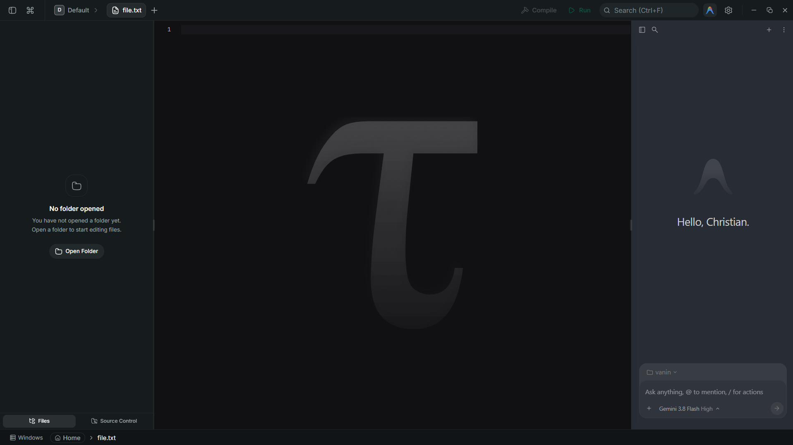

<div align="center">


# TauCode

**A lightweight, blazing-fast, open-source AI-native development environment.**

[](https://tauri.app)
[](https://www.rust-lang.org)
[](https://react.dev)
[](https://www.typescriptlang.org/)
[](https://microsoft.github.io/monaco-editor/)
[](https://tailwindcss.com/)
[](LICENSE)

<br/>

<p align="center">
  
</p>

</div>

---

## ⚡ What is TauCode?

**TauCode** is an open-source code editor and development environment built on [Tauri 2](https://tauri.app) and [Rust](https://www.rust-lang.org), designed as a high-performance, lightweight alternative to Electron-based IDEs.

Existing AI-native environments often suffer from heavy memory consumption, opaque background processes, and rigid architectures. TauCode reimagines the entire developer experience from the ground up:

- **Ultra-lightweight Footprint**: Typically **60 MB to 120 MB RAM at idle** compared to 1+ GB in traditional Electron editors.
- **Sub-second Startup**: Native Rust core with operating system native WebViews (WebView2 on Windows, WebKit on macOS and Linux) — zero Chromium overhead.
- **Privacy-first Local AI Engine**: Isolated runtime managing the Antigravity pair-programming agent, with skills and MCP integrations.
- **Extensible Architecture**: Modular JSON-manifest extension system (`taucode-extension.json`) with sandboxed iframe hosts and typed IPC.

---

## 🚀 Key Features

### 💻 Monaco Code Editor & LSP
- Powered by [Monaco Editor](https://microsoft.github.io/monaco-editor/) with complete **Language Server Protocol (LSP)** capabilities.
- Intelligent code completion, hover documentation, real-time diagnostics, and go-to-definition.
- Automatic integration with external formatters including **Prettier**, **Biome**, and **`rustfmt`**, plus built-in normalizers for JSON and XML.

### 🧠 Integrated AI Pair-Programmer
- Embedded Antigravity AI runtime (`taucode-antigravity.exe`) running locally and isolated inside the application directory.
- Context-aware side panel for code generation, terminal command execution, and file inspection.
- AI Skill system allowing users to organize workflows, playbooks, and tool integrations with one-click compile buttons.

### 🗂️ Flexible Multi-Workspace & Spaces
- Multi-workspace system (**Spaces**) allowing instant switching between independent sets of tabs and layouts within one window.
- Infinite horizontal and vertical pane splitting.
- Dockable side panels and fluid window controls.
- Native Windows `CF_HDROP` clipboard integration (`Ctrl+V` to paste files/folders directly from Windows Explorer into the workspace with automatic conflict handling).

### 🛠️ Specialized Native Viewers
- **Terminal**: High-speed PTY sessions via `portable-pty` and `xterm.js`, supporting concurrent sessions, private tabs, and clean rendering.
- **3D Model Inspector**: Interactive viewer for Blockbench `.bbmodel`, `.gltf`, `.glb`, and `.obj` files with orbit rotation, pan, zoom, and wireframe views.
- **Web Preview**: Embedded sandboxed browser for previewing local development servers.
- **Markdown Viewer**: Full GitHub Flavored Markdown renderer with KaTeX math formula rendering.
- **Vector & PDF Inspector**: Native rendering for `.svg` graphics and `.pdf` documents.
- **Git Graph & Source Control**: Visual commit graph, branch browser, and interactive diff viewer.

### 🧩 Sandboxed Extension Ecosystem
- Pure typed IPC communication between the host and extensions.
- Support for registering custom editors, tabs, and panels.
- Custom file-type associations (e.g., auto-opening custom editors for `.csv`, `.hex`, etc.).
- Global command palette actions and bundled Antigravity skills.

---

## 🏛️ Architecture Overview

```
┌────────────────────────────────────────────────────────────┐
│  Frontend  (Webview2 / WebKit)                             │
│                                                            │
│  React 19 + TypeScript + Tailwind CSS v4                   │
│  Monaco Editor  ·  Command Palette  ·  Extension Host      │
└────────────────────────┬───────────────────────────────────┘
                         │  Tauri IPC (commands + events)
┌────────────────────────▼───────────────────────────────────┐
│  Backend  (Rust)                                           │
│                                                            │
│  PTY Engine  ·  Filesystem Engine  ·  Extension Manager    │
│  Window Controls  ·  Workspace Registry  ·  LSP Bridge     │
└────────────────────────┬───────────────────────────────────┘
                         │
┌────────────────────────▼───────────────────────────────────┐
│  AI Engine  (local, isolated)                              │
│                                                            │
│  taucode-antigravity  ·  Skills  ·  MCP servers            │
└────────────────────────────────────────────────────────────┘
```

| Layer | Technology |
| :--- | :--- |
| **Application Framework** | Tauri 2.0 |
| **Backend Core** | Rust (2021 edition) |
| **Frontend Framework** | React 19 + TypeScript |
| **Styling Engine** | Tailwind CSS v4 |
| **Code Editor** | Monaco Editor 0.56 |
| **Terminal Emulation** | portable-pty + xterm.js |
| **AI Runtime** | Antigravity (isolated local runtime) |

---

## 🛠️ Building from Source

### Prerequisites
- **Rust toolchain** (stable): [rustup.rs](https://rustup.rs)
- **Node.js**: v22 or later
- **pnpm**: `npm install -g pnpm`
- **Platform Dependencies**:
  - **Windows**: Microsoft Visual C++ Build Tools
  - **Linux**: `sudo apt-get install -y libwebkit2gtk-4.1-dev libappindicator3-dev librsvg2-dev patchelf libgtk-3-dev libsoup-3.0-dev`
  - **macOS**: Xcode Command Line Tools (`xcode-select --install`)

### Setup & Development

```bash
# Clone the repository
git clone https://github.com/christianvanin/taucode.git
cd taucode

# Install frontend dependencies
pnpm install

# Start Tauri development environment
pnpm dev
```

### Verification & Quality Checks

```bash
# Type check TypeScript
pnpm check-types

# Rust backend checks
cargo check --manifest-path src-tauri/Cargo.toml
```

### Production Build

```bash
# Build production bundle and platform-specific installers
pnpm build
pnpm tauri build
```

The compiled binaries and installers (`.exe`/`.msi` on Windows, `.deb`/`.AppImage` on Linux, `.dmg` on macOS) will be generated in `src-tauri/target/release/bundle/`.

---

## 📖 Documentation

- [Extension System Overview](docs/extensions/README.md)
- [Editor Integration Guide (Monaco)](docs/extensions/editor-integration.md)
- [Manifest Specification (`taucode-extension.json`)](docs/extensions/manifest-reference.md)
- [Architecture & Internal Design](docs/architecture/api-proxy.md)

---

## 🤝 Contributing

Contributions to TauCode are welcome! Whether it's adding new LSP features, refining terminal performance, enhancing extension APIs, or fixing platform-specific UI behaviors, feel free to open an issue or pull request.

1. Fork the repository
2. Create your feature branch (`git checkout -b feature/amazing-feature`)
3. Commit your changes (`git commit -m "feat: add amazing feature"`)
4. Push to your branch (`git push origin feature/amazing-feature`)
5. Open a Pull Request

---

## 📄 License

TauCode is distributed under a custom license. See [LICENSE](LICENSE) for full details.

- **Non-Commercial Use**: Freely permitted to use, modify, and redistribute (provided the name and logo are changed in derived distributions).
- **Commercial Use**: Direct commercial resale or monetization requires explicit licensing from the author.
- **Workflow Usage**: Using TauCode as an everyday developer tool within commercial projects is completely unrestricted.
